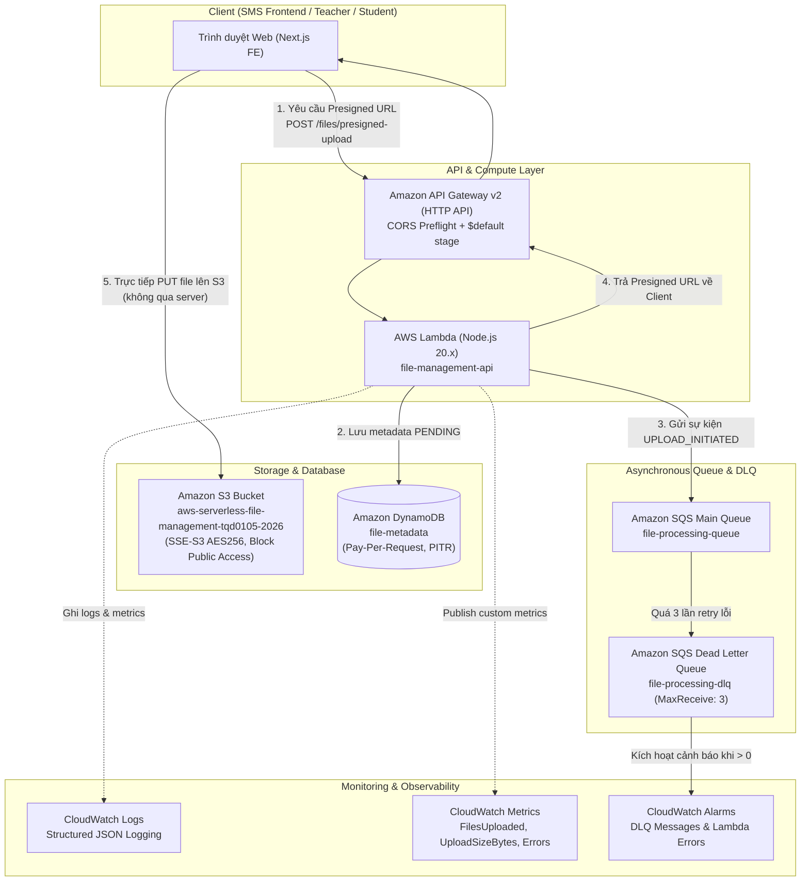

# 🚀 AWS Serverless File Management Microservice

Microservice xử lý và lưu trữ tệp tin không máy chủ (Serverless), phân tán và tự động co giãn (Auto-scaling) trên nền tảng AWS dành riêng cho Hệ thống Quản lý Học sinh (**Student Management System - SMS**).

---

## 📌 Mục lục
1. [Tổng quan kiến trúc](#-tổng-quan-kiến-trúc)
2. [Các dịch vụ AWS sử dụng](#-các-dịch-vụ-aws-sử-dụng)
3. [Hướng dẫn tích hợp vào Hệ thống SMS](#-hướng-dẫn-tích-hợp-vào-hệ-thống-sms)
4. [Tài liệu API chi tiết](#-tài-liệu-api-chi-tiết)
5. [Hạ tầng mã hóa (Infrastructure as Code - Terraform)](#-hạ-tầng-mã-hóa-terraform)
6. [Tự động hóa CI/CD (GitHub Actions)](#-tự-động-hóa-cicd-github-actions)
7. [Kiểm thử tự động (Unit Test & Verification Scripts)](#-kiểm-thử-tự-động)
8. [Cài đặt và triển khai cục bộ](#-cài-đặt-và-triển-khai-cục-bộ)

---

## 🏗 Tổng quan kiến trúc

Hệ thống được thiết kế theo mô hình **Event-Driven Serverless Architecture** đảm bảo tính sẵn sàng cao, bảo mật nhiều lớp và chi phí tối ưu (Pay-as-you-go):



---

## ☁️ Các dịch vụ AWS sử dụng

| Dịch vụ AWS | Tài nguyên cụ thể | Vai trò kiến trúc |
| :--- | :--- | :--- |
| **Amazon S3** | `aws-serverless-file-management-tqd0105-2026` | Lưu trữ file nhị phân (Ảnh đại diện, file Excel học sinh, tài liệu chứng chỉ). Kích hoạt mã hóa phía máy chủ AES-256 (`SSE-S3`), chặn hoàn toàn truy cập công khai (`Block Public Access`), cấu hình CORS cho phép domain SMS upload. |
| **AWS Lambda** | `file-management-api` | Xử lý logic nghiệp vụ serverless trên runtime `nodejs20.x`, đóng gói siêu nhẹ bằng `esbuild` (< 2MB bundle, ~340KB zip). |
| **API Gateway v2** | `file-management-http-api` | Điểm tiếp nhận request từ bên ngoài với URL: `https://83cxxukww4.execute-api.ap-southeast-1.amazonaws.com`. Tự động cấu hình CORS preflight và stage `$default`. |
| **Amazon DynamoDB** | `file-metadata` | Cơ sở dữ liệu NoSQL lưu thông tin metadata của file (UUID, s3Key, fileName, size, contentType, status, timestamps) với chế độ `PAY_PER_REQUEST`. |
| **Amazon SQS** | `file-processing-queue` | Hàng đợi tin nhắn xử lý bất đồng bộ (Asynchronous background processing) các tác vụ nặng như trích xuất dữ liệu, kiểm tra virus, index tài liệu. |
| **Amazon SQS DLQ** | `file-processing-dlq` | Dead Letter Queue cô lập các tin nhắn bị lỗi sau 3 lần retry (`maxReceiveCount: 3`) để kỹ sư kiểm tra nguyên nhân gốc rễ. |
| **CloudWatch** | Log Group `/aws/lambda/file-management-api` | Ghi log có cấu trúc chuẩn JSON (`logStructured`), Custom Metrics (`FilesUploaded`, `UploadSizeBytes`, `Errors`), và 2 Alarms cảnh báo lỗi tự động. |
| **AWS IAM** | `file-management-lambda-role` | Tuân thủ nguyên tắc đặc quyền tối thiểu (Least Privilege Principle), chỉ cấp quyền vừa đủ trên S3 bucket, DynamoDB table, SQS queue và CloudWatch logs. |

---

## 🔗 Hướng dẫn tích hợp vào Hệ thống SMS

### Kịch bản 1: Upload Avatar học sinh / giáo viên (Direct Client Upload via Presigned URL)

**Tại sao nên dùng cách này?**
File ảnh được upload **trực tiếp từ trình duyệt lên Amazon S3** thông qua một đường dẫn có chữ ký số tạm thời (Presigned URL có hạn 15 phút). Máy chủ SMS Backend / EC2 hoàn toàn **không bị nghẽn RAM/CPU** do tải dữ liệu nhị phân lớn.

#### Mã nguồn tích hợp mẫu cho Frontend (React / Next.js / TypeScript):

```typescript
// services/sms-file-upload.service.ts
const FILE_API_URL = "https://83cxxukww4.execute-api.ap-southeast-1.amazonaws.com";

export async function uploadStudentAvatar(file: File): Promise<string> {
  // Bước 1: Yêu cầu Presigned URL từ Microservice
  const presignedRes = await fetch(`${FILE_API_URL}/files/presigned-upload`, {
    method: "POST",
    headers: { "Content-Type": "application/json" },
    body: JSON.stringify({
      fileName: `avatar-${Date.now()}-${file.name}`,
      contentType: file.type || "image/png",
    }),
  });

  if (!presignedRes.ok) {
    throw new Error("Không thể tạo link tải ảnh đại diện.");
  }

  const { uploadUrl, fileId, fileName } = await presignedRes.json();

  // Bước 2: Trình duyệt đẩy trực tiếp file lên Amazon S3 bằng PUT request
  const s3UploadRes = await fetch(uploadUrl, {
    method: "PUT",
    headers: { "Content-Type": file.type || "image/png" },
    body: file,
  });

  if (!s3UploadRes.ok) {
    throw new Error("Tải file lên S3 thất bại.");
  }

  // Bước 3: Lấy đường dẫn tải file (Presigned Download URL) hoặc lưu fileId vào SMS Backend
  const downloadRes = await fetch(`${FILE_API_URL}/files/${fileId}/presigned-download`);
  const { downloadUrl } = await downloadRes.json();

  return downloadUrl; // Trả về link ảnh đại diện hiển thị cho học sinh
}
```

---

### Kịch bản 2: Import danh sách học sinh từ file Excel (Background Async Queue)

Khi giáo viên tải lên file Excel 10.000 học sinh:
1. File Excel được lưu lên S3.
2. Tin nhắn sự kiện được tự động đẩy vào **SQS `file-processing-queue`**.
3. Worker trong Lambda hoặc SMS Background Service lấy tin nhắn từ SQS (`POST /queue/process`), đọc dữ liệu từng dòng và lưu vào cơ sở dữ liệu học sinh PostgreSQL/Prisma.
4. Nếu có dòng bị lỗi hoặc file hỏng, sau 3 lần thử lại tin nhắn sẽ tự động rơi vào **SQS DLQ** và CloudWatch Alarm sẽ phát cảnh báo.

---

## 📡 Tài liệu API chi tiết

**Base URL**: `https://83cxxukww4.execute-api.ap-southeast-1.amazonaws.com`

### 1. Kiểm tra trạng thái hệ thống
- **Method**: `GET /health`
- **Response** (`200 OK`):
```json
{
  "status": "healthy",
  "service": "aws-serverless-file-management",
  "timestamp": "2026-10-07T09:50:10.691Z"
}
```

### 2. Tạo Presigned Upload URL
- **Method**: `POST /files/presigned-upload`
- **Request Body**:
```json
{
  "fileName": "student-transcript-2026.pdf",
  "contentType": "application/pdf",
  "expiresIn": 900
}
```
- **Response** (`200 OK`):
```json
{
  "uploadUrl": "https://aws-serverless-file-management-tqd0105-2026.s3.ap-southeast-1.amazonaws.com/student-transcript-2026.pdf?X-Amz-Algorithm=...",
  "fileId": "06ce0f76-8623-4942-8bba-e7c03e71aca3",
  "fileName": "student-transcript-2026.pdf",
  "expiresIn": 900
}
```

### 3. Tải file trực tiếp (Dành cho file nhỏ/Backend gọi)
- **Method**: `POST /files`
- **Request Body**:
```json
{
  "fileName": "note.txt",
  "content": "Ghi chú học tập học kỳ 1",
  "contentType": "text/plain"
}
```
- **Response** (`201 Created`):
```json
{
  "message": "File uploaded successfully",
  "fileId": "uuid-v4-string",
  "key": "note.txt",
  "sqsMessageId": "msg-id"
}
```

### 4. Lấy danh sách files đã lưu
- **Method**: `GET /files`
- **Response** (`200 OK`):
```json
{
  "files": [
    {
      "id": "06ce0f76-8623-4942-8bba-e7c03e71aca3",
      "fileName": "student-transcript-2026.pdf",
      "s3Key": "student-transcript-2026.pdf",
      "size": 10240,
      "contentType": "application/pdf",
      "status": "UPLOADED",
      "createdAt": "2026-10-07T09:50:10.000Z"
    }
  ]
}
```

### 5. Lấy metadata của file
- **Method**: `GET /files/{keyOrId}/metadata`
- **Response** (`200 OK`):
```json
{
  "metadata": {
    "id": "06ce0f76-8623-4942-8bba-e7c03e71aca3",
    "fileName": "student-transcript-2026.pdf",
    "s3Key": "student-transcript-2026.pdf",
    "size": 10240,
    "contentType": "application/pdf",
    "status": "UPLOADED"
  }
}
```

### 6. Lấy Presigned Download URL
- **Method**: `GET /files/{keyOrId}/presigned-download`
- **Response** (`200 OK`):
```json
{
  "downloadUrl": "https://aws-serverless-file-management-tqd0105-2026.s3.ap-southeast-1.amazonaws.com/student-transcript-2026.pdf?X-Amz-Signature=...",
  "key": "student-transcript-2026.pdf",
  "expiresIn": 3600
}
```

### 7. Xóa file
- **Method**: `DELETE /files/{keyOrId}`
- **Response**: `204 No Content` (Xóa hoàn toàn khỏi cả S3 bucket và DynamoDB table).

### 8. Thống kê hàng đợi SQS & DLQ
- **Method**: `GET /queue/metrics`
- **Response** (`200 OK`):
```json
{
  "metrics": {
    "approximateMessages": 0,
    "approximateMessagesNotVisible": 0,
    "dlqMessages": 0
  }
}
```

### 9. Kích hoạt xử lý hàng đợi SQS Worker
- **Method**: `POST /queue/process`
- **Response** (`200 OK`):
```json
{
  "processedCount": 1,
  "results": [
    {
      "messageId": "msg-123",
      "fileId": "file-456",
      "status": "SUCCESS"
    }
  ]
}
```

---

## 🛠 Hạ tầng mã hóa (Terraform)

Hạ tầng được định nghĩa hoàn toàn bằng mã (**Infrastructure as Code**) trong thư mục `terraform/` bao gồm 10 tệp module chuyên biệt:

- `main.tf`: Provider AWS (`hashicorp/aws ~> 5.0`), region `ap-southeast-1`.
- `variables.tf`: Biến cấu hình môi trường linh hoạt.
- `s3.tf`: S3 Bucket, mã hóa AES-256 SSE, chặn truy cập công khai và phân quyền CORS.
- `dynamodb.tf`: DynamoDB table với partition key `id` và chế độ tự co giãn Pay-Per-Request.
- `sqs.tf`: Main Queue và Dead Letter Queue với RedrivePolicy (`maxReceiveCount: 3`).
- `iam.tf`: Phân quyền IAM Role và IAM Policy với đặc quyền tối thiểu.
- `lambda.tf`: Cấu hình Lambda Function, timeout, memory, và biến môi trường.
- `api_gateway.tf`: Cấu hình HTTP API v2, route proxy integrations, và auto-deployment.
- `cloudwatch.tf`: Log Group, retention 14 ngày, và Metric Alarms.
- `outputs.tf`: Xuất Endpoint URL, Bucket ARN, Queue URL và Table Name.

### Lệnh thực thi:
```bash
cd terraform
terraform init
terraform fmt -check
terraform validate
terraform plan
```

---

## 🤖 Tự động hóa CI/CD (GitHub Actions)

Quy trình tự động hóa CI/CD được cấu hình tại [`.github/workflows/serverless-file-management-ci-cd.yml`](file:///e:/AB_Applications/VISUAL%20STUDIO%20CODE/PRO%20PROJECTS/student-management-system/.github/workflows/serverless-file-management-ci-cd.yml):

### 1. Job `ci` (Continuous Integration)
- **Kích hoạt**: Mỗi khi có `push` hoặc `pull_request` vào nhánh `main` hoặc `dev` có thay đổi trong `aws-serverless-file-management/**`.
- **Nhiệm vụ**:
  - Kiểm tra kiểu dữ liệu TypeScript (`pnpm typecheck`).
  - Chạy toàn bộ **50 bài Unit Tests** tự động (`pnpm test`).
  - Kiểm tra chuẩn mã nguồn Terraform (`terraform fmt -check`).
  - Xác thực cú pháp hạ tầng đám mây (`terraform validate`).

### 2. Job `cd` (Continuous Deployment)
- **Kích hoạt**: Tự động chạy sau khi Job `ci` thành công 100% trên nhánh `main` hoặc `dev`.
- **Nhiệm vụ**:
  - Build mã nguồn Lambda siêu nhẹ bằng `esbuild` (`pnpm build:lambda`).
  - Đóng gói file nén `function.zip`.
  - Kết nối bảo mật AWS qua **GitHub Repository Secrets** (`AWS_ACCESS_KEY_ID`, `AWS_SECRET_ACCESS_KEY`, `AWS_REGION`).
  - Cập nhật mã nguồn Lambda `file-management-api` mà **không gây gián đoạn dịch vụ (Zero Downtime)**.
  - Chờ trạng thái cập nhật hoàn tất (`aws lambda wait function-updated`).

---

## 🧪 Kiểm thử tự động

### Unit Tests (Vitest)
Dự án có **50 bài kiểm thử đơn vị** sử dụng `aws-sdk-client-mock`, bao phủ 100% các tình huống biên và logic nghiệp vụ:
- `tests/s3.service.test.ts`: Kiểm tra upload, download, presigned URL, xóa file trên S3.
- `tests/lambda.handler.test.ts`: Kiểm tra 21 kịch bản định tuyến HTTP API Gateway và xử lý mã lỗi.
- `tests/dynamodb.service.test.ts`: Kiểm tra thao tác CRUD metadata trên DynamoDB.
- `tests/sqs.service.test.ts`: Kiểm tra gửi/nhận tin nhắn hàng đợi và định tuyến DLQ.
- `tests/cloudwatch.service.test.ts`: Kiểm tra structured logging và ghi nhận metrics.

Chạy test cục bộ:
```bash
pnpm test
```

### Bộ Scripts kiểm định thực tế trên AWS (Live Verification Scripts)
Hệ thống cung cấp sẵn 8 script kiểm thử trực tiếp:
```bash
pnpm tsx scripts/verify-s3.ts           # Bước 1: Kiểm thử Amazon S3
pnpm tsx scripts/verify-lambda.ts       # Bước 2: Kiểm thử AWS Lambda
pnpm tsx scripts/verify-api-gateway.ts  # Bước 3: Kiểm thử API Gateway
pnpm tsx scripts/verify-dynamodb.ts     # Bước 4: Kiểm thử DynamoDB
pnpm tsx scripts/verify-sqs.ts          # Bước 5: Kiểm thử SQS & DLQ
pnpm tsx scripts/verify-cloudwatch.ts   # Bước 6: Kiểm thử CloudWatch
pnpm tsx scripts/verify-terraform.ts    # Bước 7: Kiểm định Terraform
pnpm tsx scripts/verify-ci-cd.ts        # Bước 8: Kiểm định CI/CD GitHub Actions
pnpm tsx scripts/verify-full-system.ts  # Bước 9: Kiểm thử tích hợp toàn bộ hệ thống (E2E)
```

---

## 💻 Cài đặt và triển khai cục bộ

```bash
# Di chuyển vào thư mục microservice
cd aws-serverless-file-management

# Cài đặt thư viện phụ thuộc
pnpm install

# Kiểm tra kiểu TypeScript
pnpm typecheck

# Chạy toàn bộ Unit Tests
pnpm test

# Chạy kiểm thử tích hợp toàn hệ thống trực tiếp trên AWS
pnpm tsx scripts/verify-full-system.ts
```
