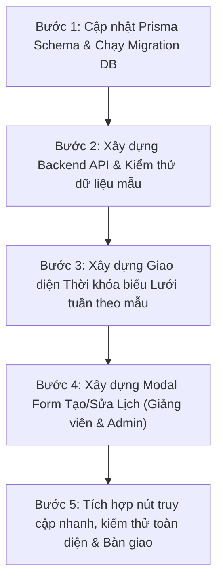

# Thiết Kế Tính Năng Thời Khóa Biểu & Lịch Học, Lịch Thi, Sự Kiện (Class Schedule & Timetable)

**Ngày tạo:** 13/10/2026  
**Dự án:** Student Management System  
**Nhánh:** `dev`  
**Trạng thái:** Chờ phê duyệt đặc tả (Spec Review)  

---

## 1. Mục Tiêu & Bối Cảnh

Hệ thống Quản lý Sinh viên (SMS) hiện đã có đầy đủ các tính năng: Điểm danh (QR code/GPS), Quản lý lớp học, Bảng điểm học vụ A4, Bài tập & Nộp tệp trực tiếp lên S3/CloudFront, và Tài liệu học tập. Tuy nhiên, hệ thống vẫn thiếu **Thời khóa biểu / Lịch học trung tâm** để liên kết các hoạt động hàng ngày của Giảng viên và Sinh viên.

Mục tiêu của thiết kế này là xây dựng module **Thời Khóa Biểu & Lịch (Schedule & Timetable)** chuẩn phong cách SaaS hiện đại (dựa trên bản mẫu thiết kế được duyệt):
- Phân biệt rõ ràng 3 phân hệ: **Lịch học (Class Schedule)**, **Lịch thi (Exam Schedule)**, và **Sự kiện tùy chỉnh (Custom Events)**.
- Giao diện lưới tuần 7 ngày (Thứ Hai ──> Chủ Nhật) kèm trục thời gian 07:00 - 18:00, vạch chỉ giờ hiện tại (Current Time Indicator), mini calendar và bộ lọc linh hoạt.
- Tự động hiển thị theo vai trò người dùng (Sinh viên xem lịch các lớp mình học; Giảng viên xem lịch các lớp mình dạy và có quyền tạo/sửa lịch).

---

## 2. Mô Hình Dữ Liệu (Prisma Schema)

Bổ sung `ScheduleEvent` và enum `ScheduleType` vào `backend/prisma/schema.prisma`:

```prisma
enum ScheduleType {
  CLASS   // Lịch học trên lớp
  EXAM    // Lịch thi (Giữa kỳ / Cuối kỳ)
  EVENT   // Sự kiện (Workshop, bảo vệ đồ án, sinh hoạt CLB)
  OTHER   // Hoạt động khác (Tự học, lịch bù)
}

model ScheduleEvent {
  id           String       @id @default(cuid())
  title        String       // Tên môn học hoặc tên sự kiện
  description  String?      // Mô tả chi tiết, nội dung bài học/đề thi
  type         ScheduleType @default(CLASS)

  // Liên kết Lớp học / Môn học (tùy chọn)
  classId      String?
  class        Class?       @relation(fields: [classId], references: [id], onDelete: Cascade)

  // Giảng viên phụ trách / Người tạo
  teacherId    String?
  teacher      User?        @relation("TeacherScheduleEvents", fields: [teacherId], references: [id], onDelete: SetNull)

  // Địa điểm & Khung giờ
  room         String       // VD: "Room A-302", "P. Thi B101", "Studio D-102", "Online Zoom"
  startTime    String       // Định dạng HH:mm, VD: "08:00"
  endTime      String       // Định dạng HH:mm, VD: "10:00"
  color        String?      // Mã màu sắc môn học, VD: "#4f46e5", "#059669", "#dc2626"

  // Quy tắc hiển thị thời gian:
  // 1. Lịch học lặp lại hàng tuần: isRecurring = true, dayOfWeek = 2..8 (2: Thứ Hai, ..., 8: Chủ Nhật)
  //    áp dụng trong khoảng [startDate, endDate] của học kỳ.
  // 2. Lịch thi & Sự kiện cụ thể: isRecurring = false, specificDate = ngày diễn ra sự kiện.
  isRecurring  Boolean      @default(false)
  dayOfWeek    Int?         // 2 = Thứ 2, 3 = Thứ 3, ..., 8 = Chủ Nhật
  specificDate DateTime?    // Ngày cụ thể đối với Lịch thi và Sự kiện
  startDate    DateTime?    // Ngày bắt đầu áp dụng lịch lặp
  endDate      DateTime?    // Ngày kết thúc học kỳ / đợt học

  createdAt    DateTime     @default(now())
  updatedAt    DateTime     @updatedAt

  @@index([classId])
  @@index([teacherId])
  @@index([type])
  @@index([specificDate])
  @@map("schedule_events")
}
```

Cập nhật quan hệ ngược trong:
- `model Class`: thêm `scheduleEvents ScheduleEvent[]`
- `model User`: thêm `scheduleEvents ScheduleEvent[] @relation("TeacherScheduleEvents")`

---

## 3. Kiến Trúc API Backend (REST Endpoints)

Tạo router `/api/schedule` với các endpoints:

| Phương thức | Đường dẫn | Phân quyền | Chức năng |
| :--- | :--- | :--- | :--- |
| `GET` | `/api/schedule/my-schedule?weekStart=YYYY-MM-DD` | Sinh viên, Giảng viên, Admin | Lấy danh sách sự kiện trong tuần được chọn. Backend tự động tổng hợp: các sự kiện có `specificDate` trong tuần + các sự kiện lặp (`isRecurring = true`) có `dayOfWeek` tương ứng trong khoảng `[startDate, endDate]`. |
| `POST` | `/api/schedule/events` | Giảng viên, Admin | Tạo mới lịch học, lịch thi hoặc sự kiện. Giảng viên chỉ được tạo cho lớp mình phụ trách. |
| `PUT` | `/api/schedule/events/:id` | Giảng viên, Admin | Cập nhật thông tin ca học/lịch thi (giờ học, phòng học, mô tả). |
| `DELETE` | `/api/schedule/events/:id` | Giảng viên, Admin | Xóa sự kiện lịch khỏi hệ thống. |
| `GET` | `/api/schedule/classes/:classId` | Đăng nhập | Lấy thời khóa biểu cụ thể của một lớp học. |

---

## 4. Thiết Kế Giao Diện Frontend (`ScheduleView.tsx` & `ScheduleModal.tsx`)

Bám sát 100% mẫu thiết kế giao diện được cung cấp:

### 4.1. Khối Header Trên Cùng
- **Tiêu đề học vụ**: `Lịch · Học kỳ 2 · Năm học 2025 – 2026`.
- **Thanh lọc loại lịch (Pill Tabs)**:
  - `Lịch học` (Màu tím/indigo)
  - `Lịch thi` (Màu đỏ/rose)
  - `Sự kiện` (Màu xanh lục/emerald)
- **Cụm điều hướng tuần**:
  - Nút `<` (Tuần trước), nút `Hôm nay`, nút `>` (Tuần tới).
  - Dropdown chọn chế độ xem: **Tuần (Mặc định)** / **Tháng** / **Danh sách**.
- **Nút hành động (Dành cho Giảng viên & Admin)**: Nút `+ Thêm lịch` để mở form tạo nhanh.

### 4.2. Cột Bên Trái (Sidebar Điều Hướng)
- **Mini Calendar Picker**: Lịch tháng thu nhỏ, click vào bất kỳ ngày nào để chuyển nhanh sang tuần chứa ngày đó.
- **Bộ lọc hiển thị lịch (Checkboxes)**:
  - ☑ Lịch học
  - ☑ Lịch thi
  - ☑ Sự kiện
  - ☑ Hoạt động khác
- **Danh mục môn học & Phân màu (Color Legend)**:
  - Ô tìm kiếm môn học nhanh.
  - Chấm màu nhận diện riêng cho từng môn học (Cơ sở dữ liệu: Xanh dương, Lập trình Web: Tím, Cloud Computing: Xanh lục...).

### 4.3. Lưới Thời Gian Trung Tâm (Weekly Calendar Grid)
- **7 Cột tương ứng 7 ngày**: Thứ Hai (ngày/tháng), Thứ Ba, ..., Chủ Nhật. Cột ngày hôm nay được làm nổi bật viền và màu nền nhẹ.
- **Trục thời gian bên trái**: Các mốc từ `07:00` đến `18:00`.
- **Vạch chỉ thời gian thực tế (Current Time Indicator)**: Đường kẻ ngang màu tím kèm badge giờ động (VD: `10:30`) di chuyển theo thời gian thực nếu đang xem tuần hiện tại.
- **Thẻ Ca Học / Lịch Thi / Sự Kiện**:
  - Định vị tọa độ chính xác theo giờ bắt đầu và độ dài thời lượng (VD: 08:00 - 10:00 chiếm 2 ô giờ).
  - Phong cách thẻ pastel mềm mại, viền trái mang màu môn học.
  - Hiển thị: Icon phân loại + Khung giờ, Tên môn/sự kiện (In đậm), Địa điểm (`Room A-302`), Tên Giảng viên, Badge loại lịch (`Lịch thi`, `Sự kiện`).
- **Tương tác khi click vào thẻ**:
  - Modal xem chi tiết sự kiện: Tên môn, phòng học, giảng viên, mô tả buổi học.
  - Tích hợp liên kết nhanh:
    - Nếu là sinh viên và đang trong giờ học $\rightarrow$ Nút **Điểm danh ngay**.
    - Nếu là giảng viên và đang trong giờ dạy $\rightarrow$ Nút **Mở điểm danh QR cho lớp này**.
    - Nút **Xem tài liệu môn học**.

---

## 5. Kế Hoạch Triển Khai Từng Bước (Step-by-Step Execution Plan)

Để đảm bảo nguyên tắc *"Làm bước nào chắc bước đó, kiểm tra kỹ càng trước khi sang bước kế tiếp"*:



- **Bước 1**: Cập nhật `backend/prisma/schema.prisma` với model `ScheduleEvent`, chạy `pnpm --filter backend exec npx prisma db push` để cập nhật cơ sở dữ liệu Supabase, xác nhận schema đồng bộ 100%.
- **Bước 2**: Viết Controller & Service cho `schedule` ở Backend: logic phân giải lịch tuần (tính toán sự kiện lặp + sự kiện cụ thể). Viết script test endpoint độc lập.
- **Bước 3**: Viết component Frontend `ScheduleCalendarView.tsx`: Mini calendar, bộ lọc, lưới tuần 7 ngày, vạch thời gian thực tế, các thẻ sự kiện.
- **Bước 4**: Viết Form tạo ca học, lịch thi và sự kiện cho Giảng viên/Admin (`CreateScheduleModal.tsx`).
- **Bước 5**: Đặt nút truy cập "Thời khóa biểu" trên thanh menu/dashboard của cả Sinh viên, Giảng viên và Admin. Kiểm thử luồng click tương tác và kiểm tra build (`next build`).

---

## 6. Tiêu Chí Nghiệm Thu (Acceptance Criteria)

1. Giao diện hiển thị đúng 100% bố cục và màu sắc của bản mẫu người dùng cung cấp.
2. Sinh viên đăng nhập nhìn thấy đúng lịch các môn học của lớp mình đã đăng ký.
3. Giảng viên đăng nhập thấy lịch dạy của mình và có thể thêm/sửa/xóa lịch học, lịch thi, sự kiện.
4. Lịch học lặp lại theo tuần tự động hiển thị trên tất cả các tuần trong khoảng thời gian học kỳ.
5. Vạch giờ hiện tại (`Current Time Line`) hiển thị chính xác theo giờ hệ thống.
6. Toàn bộ mã nguồn pass typecheck không lỗi, không ảnh hưởng đến bất kỳ tính năng cũ nào.
